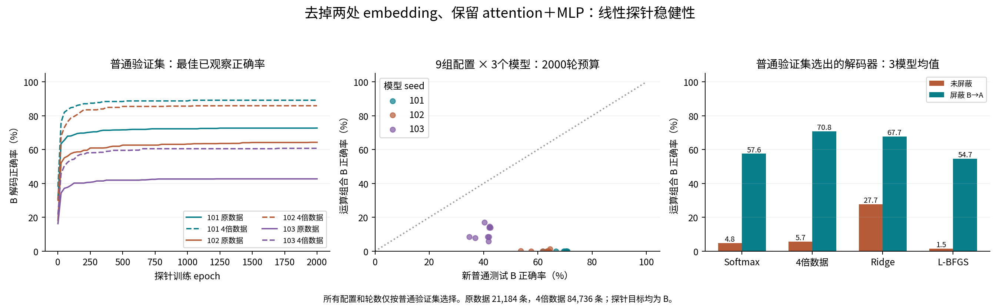

# 第一层去 embedding 后的线性探针稳健性检查

表示固定为 $z_B=a_B+\mathrm{MLP}(\mathrm{LN}_2(a_B))$，目标为从 331 个类别中解码 B。三个普通 Transformer 权重冻结，不进行模型训练。所有选择仅用普通验证集。

完整模型 seed：[101, 102, 103]；目标为 101、102、103。

## 完成情况与主要结论

本轮全部完成：三个冻结模型，每个模型九组 Softmax 探针配置训练至 2000 轮预算；另做四倍训练数据、Ridge、独立 L-BFGS 优化、标签打乱及四格匹配对照。所有配置和轮数仅按普通验证集选择。L-BFGS 的九个拟合均达到梯度无穷范数不超过 1e-6 的停止标准。训练数据、验证数据、测试数据无输入重叠；主实验 4134 行指标及补充对照 144 行指标均从保存的预测独立复核通过。

**较扎实的结论是：在这个人为去掉 embedding 残差的表示上，普通组合上学到的 Softmax 线性读取规则很难迁移到运算组合；这不只是原先训练 100 轮不充分造成的。** 四倍数据版本普通新测试平均 77.44%，运算组合平均 5.68%；保持 B 而替换 A 的匹配对照为 99.93%。固定探针后屏蔽第一层 B→A 注意力，运算组合升至 70.82%，三个 seed 均提高（0.00→55.34、0.00→57.11、17.03→100.00）。

**仍不能把这个结果等同于“B 信息消失”或“已经证明首 token 崩塌”。** Ridge 在运算组合上平均为 27.73%；探针的错误也多数不是 A。保留 A、只换 B 的四格对照同样较难（四倍数据版本 27.15%），说明 A 的身份也有影响。原模型检索训练中未出现的普通组合 9,10 / 15,20 平均只有 46.18%，所以“仅语义组合会失败”并不成立。四格对照显示组合相关的额外差异，但不能唯一归因于语义子空间机制。

这里的 Softmax 指**线性分类探针的训练方式**；主模型始终是普通 Softmax-attention Transformer。所有表格是**探针解码 B 的准确率，不是主模型生成答案的准确率**。adamw 是原数据 Softmax 探针，adamw_large 是四倍数据版本，lbfgs 是使用另一优化器拟合的线性多类逻辑回归。屏蔽只删除第一层全部注意力头中 B 位置对 A 位置的注意力连接，其余连接重新归一化；不删除整层，且屏蔽后不重新拟合探针。

此处 a_B 仍由原输入正常计算；去掉的是块内相加的 e_B，以及 MLP 输入中的 e_B。因此不能把该实验描述成“注意力完全没有接触过 B”。本轮使用重建模型的三个 seed，不是论文原始五个 checkpoint。原始短程结果保留，不用它代替本轮稳健性结果。

## 验证集选出的解码器

每列均为正确率（%）。匹配普通对照保持 B、位置、上下文不变，每条运算题使用八个不同的普通 A，且这些 A,B 对在大小两种探针训练集和验证集中均未出现。

| 模型 seed | 解码器 | 普通验证 | 原普通测试 | 新普通测试 | 运算组合 | 探针误读为 A | 屏蔽后运算组合 | 八替代 A 匹配普通对照 | 留出普通组合 9,10 / 15,20 |
|---:|---|---:|---:|---:|---:|---:|---:|---:|---:|
| 101 | adamw | 72.73 | 68.73 | 70.59 | 0.00 | 0.82 | 43.78 | 98.13 | 75.98 |
| 101 | adamw_large | 89.16 | 86.67 | 86.90 | 0.00 | 3.62 | 55.34 | 99.98 | 82.95 |
| 101 | ridge | 60.35 | 57.25 | 59.75 | 43.62 | 34.60 | 70.83 | 100.00 | 2.54 |
| 101 | lbfgs | 72.85 | 69.49 | 71.55 | 0.00 | 1.93 | 39.24 | 95.90 | 74.77 |
| 102 | adamw | 64.31 | 64.27 | 64.09 | 0.00 | 4.13 | 56.89 | 95.87 | 22.62 |
| 102 | adamw_large | 85.91 | 84.71 | 84.62 | 0.00 | 19.04 | 57.11 | 99.80 | 15.80 |
| 102 | ridge | 44.71 | 43.50 | 44.26 | 2.71 | 33.33 | 57.10 | 100.00 | 44.49 |
| 102 | lbfgs | 64.31 | 65.56 | 65.10 | 0.00 | 6.12 | 56.76 | 92.70 | 21.35 |
| 103 | adamw | 42.71 | 41.20 | 42.16 | 14.53 | 0.21 | 72.02 | 94.23 | 26.39 |
| 103 | adamw_large | 60.76 | 59.37 | 60.79 | 17.03 | 8.05 | 100.00 | 100.00 | 39.79 |
| 103 | ridge | 6.99 | 6.87 | 6.47 | 36.86 | 19.11 | 75.31 | 91.48 | 16.33 |
| 103 | lbfgs | 43.09 | 41.73 | 42.46 | 4.57 | 0.00 | 68.09 | 92.21 | 19.14 |

## 三模型均值

| 解码器 | 新普通测试 | 运算组合 | 探针误读为 A | 屏蔽后运算组合 | 八替代 A 匹配普通对照 | 留出普通组合 |
|---|---:|---:|---:|---:|---:|---:|
| adamw | 58.95 | 4.84 | 1.72 | 57.56 | 96.08 | 41.66 |
| adamw_large | 77.44 | 5.68 | 10.23 | 70.82 | 99.93 | 46.18 |
| ridge | 36.83 | 27.73 | 29.01 | 67.75 | 97.16 | 21.12 |
| lbfgs | 59.70 | 1.52 | 2.68 | 54.70 | 93.60 | 38.42 |

## 固定基准配置：延长训练

以下固定 lr=0.01、weight decay=0.01、零初始化，避免把延长训练和更换配置混为一谈。每个预算取其范围内普通验证集选出的轮数。

| 模型 seed | 训练预算 | 所选轮数 | 普通验证 | 新普通测试 | 运算组合 | 屏蔽后运算组合 |
|---:|---:|---:|---:|---:|---:|---:|
| 101 | 100 | 100 | 68.01 | 66.09 | 0.00 | 42.57 |
| 101 | 500 | 450 | 71.56 | 69.71 | 0.00 | 43.11 |
| 101 | 1000 | 775 | 72.28 | 70.39 | 0.00 | 49.09 |
| 101 | 2000 | 2000 | 72.73 | 70.59 | 0.00 | 43.78 |
| 102 | 100 | 100 | 56.12 | 57.01 | 0.00 | 56.89 |
| 102 | 500 | 500 | 62.39 | 62.22 | 0.00 | 56.97 |
| 102 | 1000 | 1000 | 63.29 | 63.46 | 0.00 | 56.97 |
| 102 | 2000 | 1500 | 64.20 | 64.09 | 0.00 | 56.69 |
| 103 | 100 | 100 | 38.14 | 37.19 | 2.67 | 48.23 |
| 103 | 500 | 450 | 41.65 | 41.18 | 11.11 | 72.84 |
| 103 | 1000 | 775 | 42.60 | 41.84 | 5.89 | 65.25 |
| 103 | 2000 | 775 | 42.60 | 41.84 | 5.89 | 65.25 |

## 全部 AdamW 配置（2000 轮预算）

| 模型 seed | 配置 | 普通验证 | 新普通测试 | 运算组合 | 屏蔽后运算组合 | 匹配普通对照 |
|---:|---|---:|---:|---:|---:|---:|
| 101 | base_zero | 72.73 | 70.59 | 0.00 | 43.78 | 98.13 |
| 101 | base_init1 | 72.70 | 70.47 | 0.00 | 48.05 | 98.48 |
| 101 | base_init2 | 72.51 | 70.53 | 0.00 | 47.81 | 98.34 |
| 101 | lr003 | 72.51 | 70.93 | 0.00 | 43.27 | 97.83 |
| 101 | lr03 | 71.68 | 69.81 | 0.00 | 55.43 | 99.99 |
| 101 | wd0 | 71.79 | 69.56 | 0.00 | 46.68 | 98.21 |
| 101 | wd01 | 69.11 | 66.70 | 0.00 | 46.21 | 99.20 |
| 101 | lr003_wd0 | 72.24 | 70.40 | 0.00 | 44.90 | 96.99 |
| 101 | lr03_wd01 | 64.92 | 61.89 | 0.00 | 45.31 | 94.86 |
| 102 | base_zero | 64.20 | 64.09 | 0.00 | 56.69 | 94.73 |
| 102 | base_init1 | 64.16 | 64.43 | 1.20 | 56.80 | 95.73 |
| 102 | base_init2 | 64.31 | 64.09 | 0.00 | 56.89 | 95.87 |
| 102 | lr003 | 63.48 | 63.64 | 0.00 | 56.98 | 97.32 |
| 102 | lr03 | 62.39 | 61.74 | 0.00 | 56.89 | 97.04 |
| 102 | wd0 | 63.10 | 63.42 | 0.00 | 56.78 | 95.22 |
| 102 | wd01 | 57.48 | 57.46 | 0.00 | 56.97 | 94.33 |
| 102 | lr003_wd0 | 62.76 | 63.24 | 0.00 | 56.97 | 96.42 |
| 102 | lr03_wd01 | 54.19 | 53.63 | 0.16 | 56.76 | 96.36 |
| 103 | base_zero | 42.60 | 41.84 | 5.89 | 65.25 | 96.25 |
| 103 | base_init1 | 42.71 | 41.93 | 8.53 | 72.28 | 97.43 |
| 103 | base_init2 | 42.71 | 42.16 | 14.53 | 72.02 | 94.23 |
| 103 | lr003 | 42.60 | 42.45 | 13.92 | 64.22 | 96.50 |
| 103 | lr03 | 41.09 | 40.37 | 17.01 | 65.77 | 96.83 |
| 103 | wd0 | 42.07 | 41.54 | 8.52 | 72.34 | 97.54 |
| 103 | wd01 | 38.71 | 36.92 | 7.94 | 54.30 | 96.62 |
| 103 | lr003_wd0 | 42.37 | 42.10 | 14.02 | 65.94 | 96.44 |
| 103 | lr03_wd01 | 36.63 | 34.79 | 8.52 | 83.33 | 100.00 |

## L-BFGS 收敛检查

目标为完整训练集上的多类交叉熵加显式 L2；使用 double precision，记录最终梯度无穷范数。阈值为 1e-6。

| 模型 seed | L2 | 迭代次数 | 最终梯度 | 达到阈值 | 普通验证 | 运算组合 |
|---:|---:|---:|---:|---|---:|---:|
| 101 | 1e-06 | 343 | 9.68e-07 | True | 72.85 | 0.00 |
| 101 | 0.0001 | 528 | 9.84e-07 | True | 66.16 | 0.00 |
| 101 | 0.01 | 97 | 1e-06 | True | 28.13 | 0.00 |
| 102 | 1e-06 | 511 | 9.13e-07 | True | 64.31 | 0.00 |
| 102 | 0.0001 | 612 | 9.97e-07 | True | 54.80 | 0.00 |
| 102 | 0.01 | 137 | 9.71e-07 | True | 11.86 | 7.30 |
| 103 | 1e-06 | 663 | 9.38e-07 | True | 43.09 | 4.57 |
| 103 | 0.0001 | 756 | 9.3e-07 | True | 36.90 | 1.07 |
| 103 | 0.01 | 205 | 8.75e-07 | True | 10.69 | 17.03 |

## 打乱标签的负对照

| 模型 seed | 原普通测试 | 新普通测试 |
|---:|---:|---:|
| 101 | 0.34 | 0.23 |
| 102 | 0.34 | 0.24 |
| 103 | 0.26 | 0.30 |

机会水平为 1/331≈0.30%。负对照不参与解码器选择。

## 数据和解释范围

- 探针训练：21184 条；扩大后 84736 条。固定普通验证 2648 条，原普通测试 2648 条，新独立普通测试 10592 条；各类别平衡，新增训练不包含验证或测试输入。
- 三个模型 seed、三类运算符是固定的研究对象；上下文重复测量不等于独立模型或独立运算符。
- 匹配普通对照仅保证未进入探针训练，其组合可能进入过原 Transformer 的检索训练。留出的 9,10 / 15,20 对照始终同时报告。
- AdamW 权重衰减与 L-BFGS 显式 L2 不是同一优化目标。比较用于检查解码器敏感性，不宣称它们必须产生相同权重。
- 这个表示来自去掉 e_B 后重新计算 MLP 的人为干预，不是模型正常前向的隐藏状态。低分不自动证明信息擦除；解码器从普通组合迁移到运算组合失败也可能反映分布变化。
- 尚未直接测量共享语义子空间，也没有据此修改论文结论。

完整配置见 PROTOCOL.md；全部指标见 all_metrics.csv；逐样本预测及拟合权重均保留。

## 四格匹配对照（补充分析）

每个原上下文联合抽取八对 A′、B′。保持位置及其他上下文不变，三个普通反事实组合都不出现在任何探针训练集或验证集中。此分析是在发现 A 身份影响后补做，所有三个模型均报告。

| 解码器 | 原运算 AB | 只换 A：A′B | 只换 B：AB′ | 两者都换：A′B′ | 四格交互差（百分点） |
|---|---:|---:|---:|---:|---:|
| adamw | 4.84 | 96.17 | 14.30 | 54.47 | 51.16 |
| adamw_large | 5.68 | 99.92 | 27.15 | 72.65 | 48.74 |
| ridge | 27.73 | 97.16 | 55.33 | 35.25 | 89.51 |
| lbfgs | 1.52 | 93.69 | 14.98 | 55.18 | 51.96 |

交互差定义为 acc(A′B)+acc(AB′)−acc(A′B′)−acc(AB)，是描述性的概率尺度差分，不是正确率，因此可能超过 100 个百分点。正值表示四格结果存在额外组合交互；不把这一尺度上的交互唯一归因于语义。

| 模型 seed | 解码器 | 原 AB | A′B | AB′ | A′B′ | 交互差 |
|---:|---|---:|---:|---:|---:|---:|
| 101 | adamw | 0.00 | 98.14 | 15.23 | 67.10 | 46.27 |
| 101 | adamw_large | 0.00 | 99.97 | 28.88 | 83.53 | 45.33 |
| 101 | ridge | 43.62 | 100.00 | 75.27 | 57.86 | 73.78 |
| 101 | lbfgs | 0.00 | 95.90 | 17.08 | 67.78 | 45.20 |
| 102 | adamw | 0.00 | 95.98 | 20.32 | 59.97 | 56.33 |
| 102 | adamw_large | 0.00 | 99.79 | 39.65 | 81.30 | 58.14 |
| 102 | ridge | 2.71 | 100.00 | 89.40 | 42.38 | 144.31 |
| 102 | lbfgs | 0.00 | 92.93 | 21.90 | 60.98 | 53.85 |
| 103 | adamw | 14.53 | 94.38 | 7.36 | 36.34 | 50.87 |
| 103 | adamw_large | 17.03 | 100.00 | 12.92 | 53.14 | 42.76 |
| 103 | ridge | 36.86 | 91.48 | 1.32 | 5.52 | 50.43 |
| 103 | lbfgs | 4.57 | 92.22 | 5.95 | 36.76 | 56.84 |

保持 A 的初次补充对照仍保留在 afixed_results_seed*.json；四格对照使用新抽取且四格一致的 A′、B′，不将两个对照批次的数值混为一组。
