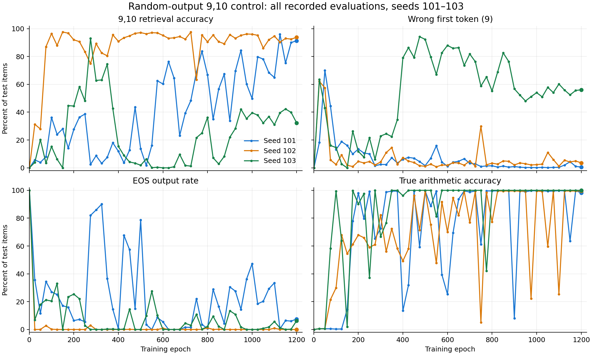

# 9,10随机输出实验：原三个seed的完整训练轨迹

图中展示全部记录的评估点，无平滑、不筛选最佳检查点。真实算术准确率单列，不包含不可预测的随机输出任务。每轮18万条随机输出训练，三seed均完整训练1200轮。

## 正确率与首token错误率（%）

每格为“检索正确率 / 错答9率”。

| Epoch | Seed101 | Seed102 | Seed103 |
|---:|---:|---:|---:|
| 25 | 5.70 / 18.16 | 31.29 / 62.11 | 3.95 / 63.52 |
| 50 | 3.95 / 70.08 | 27.93 / 57.50 | 20.23 / 43.12 |
| 75 | 7.93 / 44.41 | 86.99 / 5.66 | 3.44 / 16.05 |
| 100 | 36.13 / 13.12 | 96.45 / 2.42 | 15.27 / 14.57 |
| 150 | 28.01 / 16.09 | 97.62 / 1.84 | 0.00 / 0.00 |
| 200 | 27.62 / 13.48 | 91.99 / 4.61 | 44.41 / 11.80 |
| 275 | 2.42 / 1.52 | 74.84 / 2.03 | 92.97 / 6.09 |
| 400 | 11.88 / 6.13 | 90.94 / 7.30 | 15.43 / 79.06 |
| 500 | 13.63 / 1.56 | 97.15 / 1.13 | 1.88 / 92.30 |
| 600 | 60.27 / 1.13 | 95.16 / 1.91 | 0.00 / 87.97 |
| 800 | 66.84 / 1.45 | 90.55 / 3.36 | 36.25 / 55.23 |
| 1000 | 49.80 / 0.12 | 96.02 / 2.30 | 39.53 / 54.02 |
| 1200 | 91.29 / 0.51 | 93.79 / 3.55 | 32.27 / 56.09 |

## 轨迹说明

101早期检索很低，且有较多EOS；中后期仍有明显波动，1125轮达到96.05%，1200轮为91.29%。
102在25/50轮首token错误较多，75–150轮检索明显改善，之后大部分评估处于较高准确率，1200轮为93.79%。
103在275轮达到92.97%，此后退化；500轮正确率1.88%、首token错误92.30%，600轮正确率0%；1200轮正确率32.27%、首token错误56.09%。晚期真实算术约100%、普通检索约99%，该对检索仍差。

早期高首token错误不足以预测最终结果，短暂高准确率也不等于稳定成功；固定1200轮结论与完整轨迹需一起报告。

完整逐点数据：curves.csv；可导出的矢量图：training_curves.pdf。
