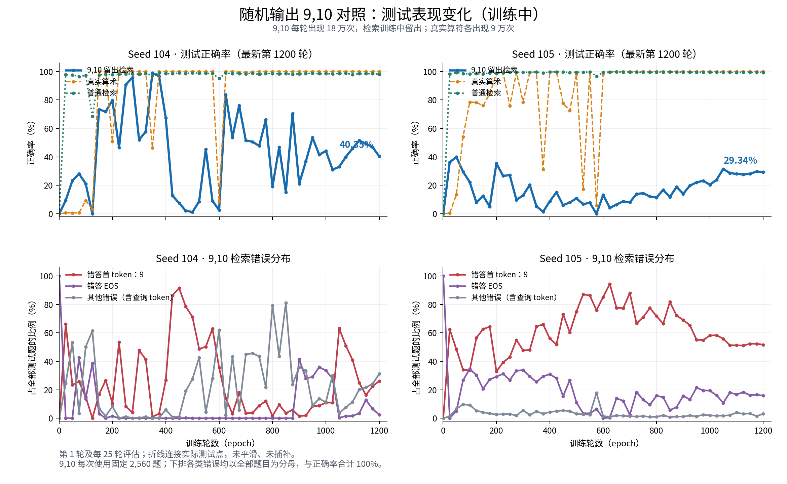

# 随机输出 9,10：104、105 测试曲线

生成时间：2026-11-08T14:41:08.885563+08:00

这是一份生成时的快照。训练继续进行；运行 `python figures/plot_random_operator_104_105.py` 可更新曲线。

[PDF](test_accuracy_curves.pdf) · [逐次测试数据 CSV](test_curves.csv)

| Seed | 最新测试轮数 | 9,10 正确率 | 错答 9 | EOS | 真实算术 | 普通检索 |
|---|---:|---:|---:|---:|---:|---:|
| 104 | 1200 | 40.35% | 26.13% | 2.38% | 100.00% | 98.05% |
| 105 | 1200 | 29.34% | 51.64% | 15.86% | 99.98% | 99.25% |

所有曲线使用保存的原始评估计数。测试点之间的行为未作估计，不以曲线峰值替代固定终点结果。
