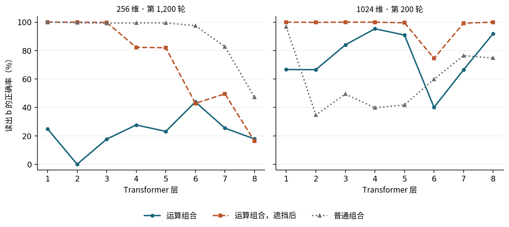

# 8 层 Transformer 逐层读出 b · seed 106

256 维使用第 1,200 轮完整权重，1024 维使用第 200 轮完整权重。表中准确率由保存的逐题预测重新计数。

1024 维的第 200 轮正处于训练损失尖峰。第 198、199、200 轮平均损失分别为 0.190、1.759、5.165。该检查点的模型直接检索时答对 2/7,680 题，7,668 题输出 EOS。256 维第 1,200 轮直接检索答对 896/7,680 题。各层表中的百分数是独立探针的读出结果。

已完成并核验 16/16 个探针。每个宽度、每层独立拟合一个。

| 层 | 256 维普通 | 256 维运算组合 | 256 维运算组合遮挡后 | 1024 维普通 | 1024 维运算组合 | 1024 维运算组合遮挡后 |
|---:|---:|---:|---:|---:|---:|---:|
| 1 | 100.00% | 24.90% | 100.00% | 96.79% | 66.67% | 100.00% |
| 2 | 99.62% | 0.03% | 99.93% | 34.74% | 66.55% | 99.82% |
| 3 | 99.32% | 17.72% | 99.74% | 49.40% | 84.02% | 100.00% |
| 4 | 99.47% | 27.66% | 82.28% | 39.77% | 95.33% | 99.97% |
| 5 | 99.43% | 23.16% | 81.98% | 41.77% | 90.92% | 99.56% |
| 6 | 97.51% | 43.88% | 42.86% | 59.86% | 40.04% | 74.51% |
| 7 | 82.74% | 25.44% | 49.57% | 76.44% | 66.50% | 99.27% |
| 8 | 47.24% | 17.84% | 16.29% | 74.74% | 91.90% | 100.00% |

## 各运算组合的读出正确率

| 宽度 | 层 | 01 | 02 | 21 | 01 遮挡后 | 02 遮挡后 | 21 遮挡后 |
|---:|---:|---:|---:|---:|---:|---:|---:|
| 256 | 1 | 0.00% | 53.16% | 21.52% | 100.00% | 100.00% | 100.00% |
| 256 | 2 | 0.00% | 0.00% | 0.08% | 100.00% | 99.80% | 100.00% |
| 256 | 3 | 0.00% | 53.16% | 0.00% | 100.00% | 99.22% | 100.00% |
| 256 | 4 | 0.23% | 66.05% | 16.68% | 100.00% | 46.84% | 100.00% |
| 256 | 5 | 0.12% | 53.16% | 16.21% | 99.69% | 46.64% | 99.61% |
| 256 | 6 | 2.38% | 59.14% | 70.12% | 41.84% | 46.21% | 40.55% |
| 256 | 7 | 0.00% | 76.13% | 0.20% | 25.04% | 98.52% | 25.16% |
| 256 | 8 | 0.00% | 53.16% | 0.35% | 4.88% | 39.65% | 4.34% |
| 1024 | 1 | 100.00% | 100.00% | 0.00% | 100.00% | 100.00% | 100.00% |
| 1024 | 2 | 99.65% | 100.00% | 0.00% | 99.61% | 100.00% | 99.84% |
| 1024 | 3 | 99.80% | 100.00% | 52.27% | 100.00% | 100.00% | 100.00% |
| 1024 | 4 | 86.33% | 100.00% | 99.65% | 99.96% | 100.00% | 99.96% |
| 1024 | 5 | 78.48% | 100.00% | 94.30% | 99.18% | 100.00% | 99.49% |
| 1024 | 6 | 25.66% | 94.45% | 0.00% | 62.15% | 100.00% | 61.37% |
| 1024 | 7 | 99.49% | 100.00% | 0.00% | 98.87% | 100.00% | 98.95% |
| 1024 | 8 | 99.38% | 100.00% | 76.33% | 100.00% | 100.00% | 100.00% |

## 实验口径

每一层都在显示序列中第二个成分 b 的位置读取注意力输出（经过输出投影）加上正常的 MLP 输出。MLP 使用原本的输入。模型向下一层传递完整的残差状态，只有交给探针的向量省去本块外侧直连项。输入在 b 后截断，未来查询和答案不进入前向计算。

沿用 Qwen3-8B 逐层实验的 Softmax 拟合函数。对 toy 模型原有的 331 类普通组合，每类取 64 条训练、8 条验证、8 条独立测试，共 21,184 / 2,648 / 2,648 条。三个运算组合不出现在探针训练序列中，各有 2,560 条测试题，共 7,680 条。仅用训练集标准化，零初始化，AdamW 学习率 0.001，权重衰减 0.01，batch 256，训练 100 轮。每一轮按普通验证集正确数选最佳，平手按交叉熵选。

遮挡测试从第一层到当前层，在所有头中屏蔽 b 对紧邻前项 a 的注意力。沿用对应层已训练好的基线读取器和标准化参数。两种宽度共享题目，两者的训练轮数不同。逐题预测和读取器分宽度保存在 w256、w1024 目录。
