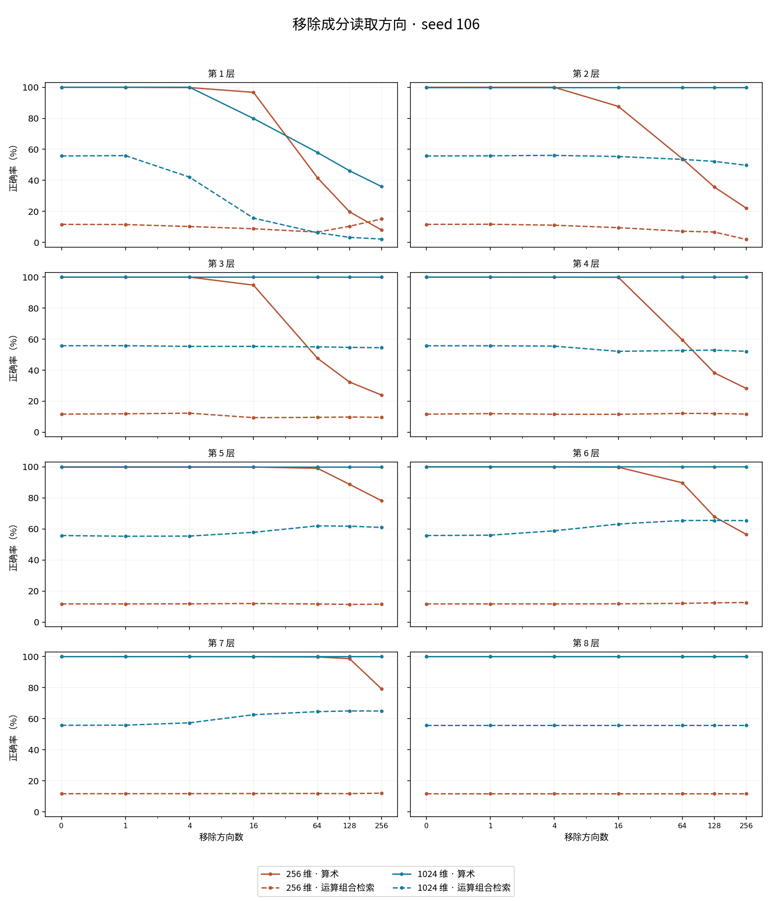
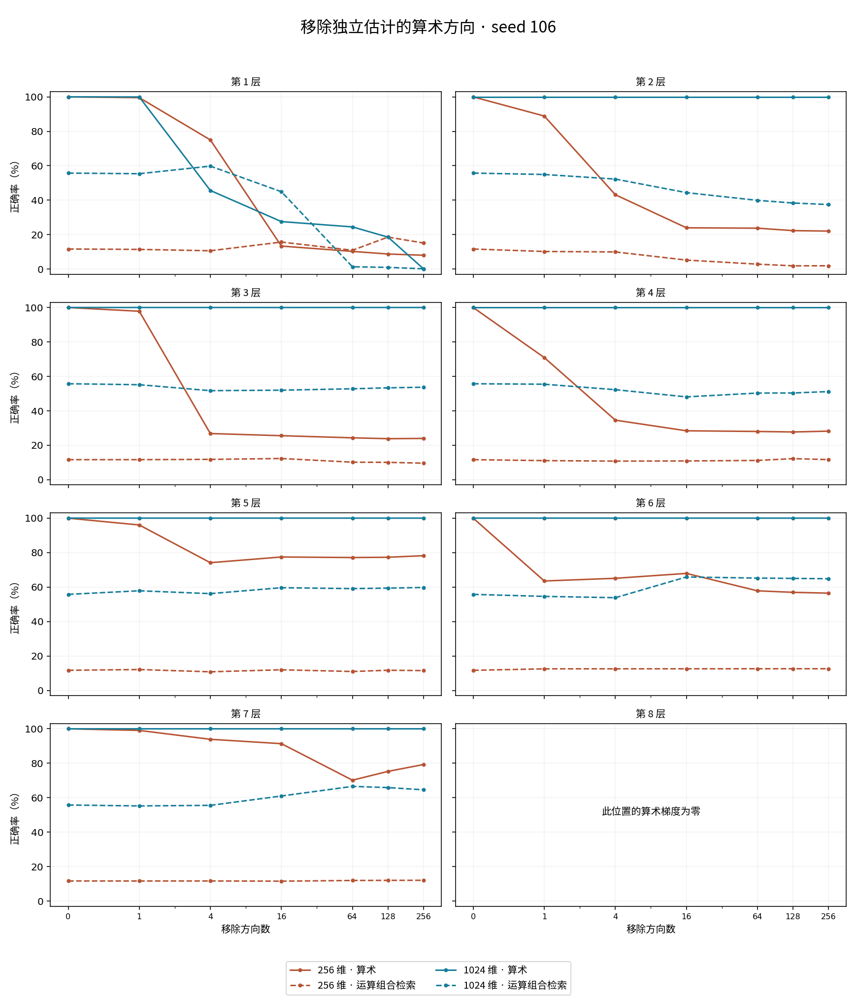

# 移除方向数量与算术、检索准确率

## 观察结果

第二层移除读取方向呈现宽度差异。256 维模型移除 16、64、128、256 个方向后，算术准确率依次为 87.68%、53.95%、35.74%、22.08%；1024 维在这些条件下均为 99.99%。匹配宽度比例时，窄模型 16/256 对应宽模型 64/1024，窄模型 64/256 对应宽模型 256/1024，差异仍然存在。

第二层窄模型的方向具有一定针对性。移除 64 个读取方向后算术为 53.95%，两组同秩、逐题同扰动长度的随机对照为 65.97% 和 63.07%。宽模型的这些随机对照也保持 99.99%。

宽模型第一层在四维尺度上出现功能区分。原算术为 99.99%，运算组合检索为 55.74%。移除四个读取方向后分别为 99.99% 和 42.11%；移除四个独立估计的算术方向后分别为 45.66% 和 59.79%。后者的两组匹配随机对照算术均为 99.99%。继续扩大移除维数，两项任务可同时受损。

层间效果不同。第一层移除 16 个读取方向时，窄模型算术为 96.72%，宽模型为 79.88%，与第二层的相对敏感性不同。当前结果支持部分层、部分干预规模下功能可以分别访问。宽度效应的普遍性和子空间几何解释仍需更多匹配检查点和随机种子验证。

本轮依据全扫描后报告这些有代表性的点，完整表格保留全部方向数、层和随机对照。算术方向的定义也更新为独立估计，因此与前轮固定 16 维且强制正交的算术方向干预存在方法差异。

## 实验设置

seed 106，八层模型，256 维固定第 1,200 轮，1024 维固定第 250 轮。与前轮相同的冻结权重、输入和测试题。当前完成 540/540 个干预条件。

读取方向来自普通组合探针，恢复到原始坐标后按奇异值排序。算术方向来自算术训练样本上的输出梯度，独立进行 SVD，本轮不再施加与读取方向正交的约束。每组取前 1、4、16、64、128、256 个方向，因此同一类型的子空间随方向数递增而嵌套。

每次移除 b 位置本层“注意力＋正常 MLP”更新量在这些方向上的投影，随后继续计算。每个目标条件附两组随机子空间对照，逐题匹配移除向量的欧氏长度。保留外侧残差。全部八层都测试；最后一层 b 位置无法再影响后面的答案位置，算术梯度为零。

方向数和宽度比例均需对照。例如 16/256 对应 64/1024，64/256 对应 256/1024。训练轮数不同，当前结果描述两份固定权重的内部干预效应。

## 曲线

[全部条件与随机对照 CSV](metrics.csv) · [复核记录](audit.json)

## 同方向数量的定向干预

| 层 | 方向 | 移除数 | 256 算术 | 1024 算术 | 256 普通检索 | 1024 普通检索 | 256 运算组合检索 | 1024 运算组合检索 |
|---:|---|---:|---:|---:|---:|---:|---:|---:|
| 1 | 读取 | 1 | 99.96 | 99.99 | 99.95 | 99.85 | 11.56 | 55.98 |
| 1 | 读取 | 4 | 99.80 | 99.99 | 99.90 | 95.90 | 10.30 | 42.11 |
| 1 | 读取 | 16 | 96.72 | 79.88 | 99.75 | 49.10 | 8.85 | 15.70 |
| 1 | 读取 | 64 | 41.69 | 57.97 | 98.50 | 6.15 | 6.69 | 6.30 |
| 1 | 读取 | 128 | 19.79 | 46.21 | 94.70 | 5.00 | 10.46 | 3.32 |
| 1 | 读取 | 256 | 8.05 | 36.05 | 60.50 | 2.70 | 15.17 | 2.20 |
| 1 | 算术 | 1 | 99.53 | 99.93 | 98.95 | 98.45 | 11.46 | 55.38 |
| 1 | 算术 | 4 | 74.99 | 45.66 | 99.05 | 97.95 | 10.66 | 59.79 |
| 1 | 算术 | 16 | 13.39 | 27.60 | 97.20 | 66.45 | 15.72 | 44.93 |
| 1 | 算术 | 64 | 10.30 | 24.51 | 70.80 | 1.25 | 10.96 | 1.37 |
| 1 | 算术 | 128 | 8.78 | 18.58 | 60.35 | 0.20 | 18.59 | 1.03 |
| 1 | 算术 | 256 | 8.06 | 0.20 | 60.60 | 0.15 | 15.17 | 0.20 |
| 2 | 读取 | 1 | 99.98 | 99.99 | 100.00 | 99.95 | 11.76 | 55.86 |
| 2 | 读取 | 4 | 99.96 | 99.99 | 99.95 | 99.95 | 11.13 | 56.12 |
| 2 | 读取 | 16 | 87.68 | 99.99 | 99.95 | 99.95 | 9.57 | 55.39 |
| 2 | 读取 | 64 | 53.95 | 99.99 | 99.85 | 99.95 | 7.27 | 53.53 |
| 2 | 读取 | 128 | 35.74 | 99.99 | 99.50 | 99.90 | 6.73 | 52.25 |
| 2 | 读取 | 256 | 22.08 | 99.99 | 57.60 | 99.90 | 1.97 | 49.73 |
| 2 | 算术 | 1 | 88.86 | 99.99 | 99.95 | 99.95 | 10.25 | 54.93 |
| 2 | 算术 | 4 | 43.19 | 99.99 | 99.90 | 99.85 | 9.99 | 52.27 |
| 2 | 算术 | 16 | 23.99 | 99.99 | 99.00 | 99.80 | 5.26 | 44.40 |
| 2 | 算术 | 64 | 23.77 | 99.99 | 80.25 | 98.95 | 2.89 | 39.92 |
| 2 | 算术 | 128 | 22.36 | 99.99 | 61.40 | 98.45 | 1.93 | 38.39 |
| 2 | 算术 | 256 | 22.08 | 99.99 | 57.60 | 98.35 | 1.95 | 37.49 |
| 3 | 读取 | 1 | 99.97 | 99.99 | 100.00 | 99.95 | 11.93 | 55.78 |
| 3 | 读取 | 4 | 99.97 | 99.99 | 100.00 | 99.95 | 12.30 | 55.34 |
| 3 | 读取 | 16 | 94.78 | 99.99 | 99.90 | 99.95 | 9.43 | 55.33 |
| 3 | 读取 | 64 | 47.67 | 99.99 | 99.95 | 99.95 | 9.62 | 55.01 |
| 3 | 读取 | 128 | 32.36 | 99.99 | 99.90 | 99.95 | 9.82 | 54.70 |
| 3 | 读取 | 256 | 24.00 | 99.99 | 99.80 | 99.95 | 9.64 | 54.45 |
| 3 | 算术 | 1 | 97.81 | 99.99 | 99.90 | 99.95 | 11.68 | 55.17 |
| 3 | 算术 | 4 | 26.84 | 99.99 | 99.85 | 99.95 | 11.85 | 51.72 |
| 3 | 算术 | 16 | 25.59 | 99.98 | 99.90 | 99.95 | 12.34 | 52.01 |
| 3 | 算术 | 64 | 24.36 | 99.99 | 99.90 | 99.95 | 10.21 | 52.81 |
| 3 | 算术 | 128 | 23.85 | 99.99 | 99.65 | 99.95 | 10.12 | 53.37 |
| 3 | 算术 | 256 | 24.00 | 99.98 | 99.80 | 99.95 | 9.64 | 53.71 |
| 4 | 读取 | 1 | 99.97 | 99.99 | 99.95 | 99.95 | 12.02 | 55.73 |
| 4 | 读取 | 4 | 99.93 | 99.99 | 99.95 | 99.95 | 11.60 | 55.49 |
| 4 | 读取 | 16 | 99.81 | 99.99 | 99.85 | 99.95 | 11.58 | 52.14 |
| 4 | 读取 | 64 | 59.49 | 99.99 | 99.40 | 99.95 | 12.16 | 52.71 |
| 4 | 读取 | 128 | 38.27 | 99.99 | 99.45 | 99.95 | 12.11 | 52.92 |
| 4 | 读取 | 256 | 28.21 | 99.99 | 97.90 | 99.95 | 11.72 | 52.16 |
| 4 | 算术 | 1 | 70.92 | 99.99 | 99.95 | 100.00 | 11.12 | 55.46 |
| 4 | 算术 | 4 | 34.60 | 99.99 | 99.90 | 99.95 | 10.83 | 52.29 |
| 4 | 算术 | 16 | 28.43 | 99.99 | 99.75 | 100.00 | 10.92 | 48.11 |
| 4 | 算术 | 64 | 28.04 | 99.99 | 99.30 | 99.95 | 11.22 | 50.33 |
| 4 | 算术 | 128 | 27.74 | 99.99 | 98.65 | 99.80 | 12.28 | 50.38 |
| 4 | 算术 | 256 | 28.23 | 99.99 | 97.90 | 99.85 | 11.72 | 51.20 |
| 5 | 读取 | 1 | 99.97 | 99.99 | 99.95 | 99.95 | 11.69 | 55.27 |
| 5 | 读取 | 4 | 99.96 | 99.99 | 99.95 | 99.95 | 11.76 | 55.39 |
| 5 | 读取 | 16 | 99.89 | 99.99 | 99.95 | 99.95 | 11.95 | 57.81 |
| 5 | 读取 | 64 | 99.06 | 99.99 | 99.95 | 99.95 | 11.65 | 61.98 |
| 5 | 读取 | 128 | 88.73 | 99.99 | 99.95 | 99.95 | 11.37 | 61.76 |
| 5 | 读取 | 256 | 78.19 | 99.99 | 99.95 | 99.95 | 11.51 | 60.98 |
| 5 | 算术 | 1 | 96.01 | 99.99 | 99.95 | 99.95 | 12.12 | 57.83 |
| 5 | 算术 | 4 | 74.14 | 99.99 | 99.95 | 99.95 | 10.81 | 56.17 |
| 5 | 算术 | 16 | 77.44 | 100.00 | 99.95 | 99.90 | 11.98 | 59.61 |
| 5 | 算术 | 64 | 77.12 | 100.00 | 99.95 | 99.90 | 10.99 | 59.08 |
| 5 | 算术 | 128 | 77.29 | 99.99 | 99.95 | 99.90 | 11.71 | 59.38 |
| 5 | 算术 | 256 | 78.19 | 99.99 | 99.95 | 99.90 | 11.51 | 59.75 |
| 6 | 读取 | 1 | 99.97 | 99.99 | 99.95 | 99.95 | 11.69 | 55.96 |
| 6 | 读取 | 4 | 99.97 | 99.99 | 99.95 | 99.95 | 11.68 | 58.79 |
| 6 | 读取 | 16 | 99.77 | 99.98 | 99.95 | 99.95 | 11.77 | 63.14 |
| 6 | 读取 | 64 | 89.71 | 99.98 | 99.95 | 99.90 | 12.03 | 65.42 |
| 6 | 读取 | 128 | 67.85 | 99.98 | 99.95 | 99.85 | 12.41 | 65.47 |
| 6 | 读取 | 256 | 56.43 | 99.98 | 99.95 | 99.75 | 12.59 | 65.35 |
| 6 | 算术 | 1 | 63.52 | 99.99 | 99.95 | 99.95 | 12.51 | 54.57 |
| 6 | 算术 | 4 | 65.07 | 99.98 | 99.95 | 99.80 | 12.54 | 53.82 |
| 6 | 算术 | 16 | 67.91 | 99.98 | 99.95 | 99.85 | 12.55 | 65.83 |
| 6 | 算术 | 64 | 57.80 | 99.98 | 99.95 | 99.60 | 12.58 | 65.20 |
| 6 | 算术 | 128 | 56.93 | 99.98 | 99.95 | 99.50 | 12.58 | 65.01 |
| 6 | 算术 | 256 | 56.45 | 99.98 | 99.95 | 99.25 | 12.59 | 64.80 |
| 7 | 读取 | 1 | 99.97 | 99.99 | 99.95 | 99.95 | 11.71 | 55.85 |
| 7 | 读取 | 4 | 99.97 | 99.99 | 99.95 | 99.95 | 11.73 | 57.36 |
| 7 | 读取 | 16 | 99.94 | 99.99 | 99.95 | 99.85 | 11.80 | 62.57 |
| 7 | 读取 | 64 | 99.76 | 99.99 | 99.95 | 99.90 | 11.82 | 64.54 |
| 7 | 读取 | 128 | 98.68 | 99.99 | 99.95 | 99.95 | 11.74 | 65.01 |
| 7 | 读取 | 256 | 79.24 | 99.99 | 99.95 | 99.90 | 12.04 | 64.93 |
| 7 | 算术 | 1 | 99.03 | 99.99 | 99.95 | 99.95 | 11.64 | 55.21 |
| 7 | 算术 | 4 | 93.89 | 99.99 | 99.95 | 99.85 | 11.67 | 55.55 |
| 7 | 算术 | 16 | 91.35 | 99.99 | 99.95 | 99.85 | 11.55 | 60.98 |
| 7 | 算术 | 64 | 70.15 | 99.99 | 99.95 | 99.85 | 11.94 | 66.55 |
| 7 | 算术 | 128 | 75.26 | 99.99 | 99.95 | 99.70 | 12.02 | 65.86 |
| 7 | 算术 | 256 | 79.25 | 99.99 | 99.95 | 99.75 | 12.04 | 64.57 |
| 8 | 读取 | 1 | 99.97 | 99.99 | 99.95 | 99.95 | 11.68 | 55.74 |
| 8 | 读取 | 4 | 99.97 | 99.99 | 99.95 | 99.95 | 11.68 | 55.74 |
| 8 | 读取 | 16 | 99.97 | 99.99 | 99.95 | 99.95 | 11.68 | 55.74 |
| 8 | 读取 | 64 | 99.97 | 99.99 | 99.95 | 99.95 | 11.68 | 55.74 |
| 8 | 读取 | 128 | 99.97 | 99.99 | 99.95 | 99.95 | 11.68 | 55.74 |
| 8 | 读取 | 256 | 99.97 | 99.99 | 99.95 | 99.95 | 11.68 | 55.74 |

## 同宽度比例的比较

| 层 | 方向 | 移除比例 | 窄模型方向数 | 宽模型方向数 | 窄模型算术 | 宽模型算术 | 窄模型运算检索 | 宽模型运算检索 |
|---:|---|---:|---:|---:|---:|---:|---:|---:|
| 1 | 读取 | 0.39% | 1 | 4 | 99.96 | 99.99 | 11.56 | 42.11 |
| 1 | 读取 | 1.56% | 4 | 16 | 99.80 | 79.88 | 10.30 | 15.70 |
| 1 | 读取 | 6.25% | 16 | 64 | 96.72 | 57.97 | 8.85 | 6.30 |
| 1 | 读取 | 25.00% | 64 | 256 | 41.69 | 36.05 | 6.69 | 2.20 |
| 1 | 算术 | 0.39% | 1 | 4 | 99.53 | 45.66 | 11.46 | 59.79 |
| 1 | 算术 | 1.56% | 4 | 16 | 74.99 | 27.60 | 10.66 | 44.93 |
| 1 | 算术 | 6.25% | 16 | 64 | 13.39 | 24.51 | 15.72 | 1.37 |
| 1 | 算术 | 25.00% | 64 | 256 | 10.30 | 0.20 | 10.96 | 0.20 |
| 2 | 读取 | 0.39% | 1 | 4 | 99.98 | 99.99 | 11.76 | 56.12 |
| 2 | 读取 | 1.56% | 4 | 16 | 99.96 | 99.99 | 11.13 | 55.39 |
| 2 | 读取 | 6.25% | 16 | 64 | 87.68 | 99.99 | 9.57 | 53.53 |
| 2 | 读取 | 25.00% | 64 | 256 | 53.95 | 99.99 | 7.27 | 49.73 |
| 2 | 算术 | 0.39% | 1 | 4 | 88.86 | 99.99 | 10.25 | 52.27 |
| 2 | 算术 | 1.56% | 4 | 16 | 43.19 | 99.99 | 9.99 | 44.40 |
| 2 | 算术 | 6.25% | 16 | 64 | 23.99 | 99.99 | 5.26 | 39.92 |
| 2 | 算术 | 25.00% | 64 | 256 | 23.77 | 99.99 | 2.89 | 37.49 |
| 3 | 读取 | 0.39% | 1 | 4 | 99.97 | 99.99 | 11.93 | 55.34 |
| 3 | 读取 | 1.56% | 4 | 16 | 99.97 | 99.99 | 12.30 | 55.33 |
| 3 | 读取 | 6.25% | 16 | 64 | 94.78 | 99.99 | 9.43 | 55.01 |
| 3 | 读取 | 25.00% | 64 | 256 | 47.67 | 99.99 | 9.62 | 54.45 |
| 3 | 算术 | 0.39% | 1 | 4 | 97.81 | 99.99 | 11.68 | 51.72 |
| 3 | 算术 | 1.56% | 4 | 16 | 26.84 | 99.98 | 11.85 | 52.01 |
| 3 | 算术 | 6.25% | 16 | 64 | 25.59 | 99.99 | 12.34 | 52.81 |
| 3 | 算术 | 25.00% | 64 | 256 | 24.36 | 99.98 | 10.21 | 53.71 |
| 4 | 读取 | 0.39% | 1 | 4 | 99.97 | 99.99 | 12.02 | 55.49 |
| 4 | 读取 | 1.56% | 4 | 16 | 99.93 | 99.99 | 11.60 | 52.14 |
| 4 | 读取 | 6.25% | 16 | 64 | 99.81 | 99.99 | 11.58 | 52.71 |
| 4 | 读取 | 25.00% | 64 | 256 | 59.49 | 99.99 | 12.16 | 52.16 |
| 4 | 算术 | 0.39% | 1 | 4 | 70.92 | 99.99 | 11.12 | 52.29 |
| 4 | 算术 | 1.56% | 4 | 16 | 34.60 | 99.99 | 10.83 | 48.11 |
| 4 | 算术 | 6.25% | 16 | 64 | 28.43 | 99.99 | 10.92 | 50.33 |
| 4 | 算术 | 25.00% | 64 | 256 | 28.04 | 99.99 | 11.22 | 51.20 |
| 5 | 读取 | 0.39% | 1 | 4 | 99.97 | 99.99 | 11.69 | 55.39 |
| 5 | 读取 | 1.56% | 4 | 16 | 99.96 | 99.99 | 11.76 | 57.81 |
| 5 | 读取 | 6.25% | 16 | 64 | 99.89 | 99.99 | 11.95 | 61.98 |
| 5 | 读取 | 25.00% | 64 | 256 | 99.06 | 99.99 | 11.65 | 60.98 |
| 5 | 算术 | 0.39% | 1 | 4 | 96.01 | 99.99 | 12.12 | 56.17 |
| 5 | 算术 | 1.56% | 4 | 16 | 74.14 | 100.00 | 10.81 | 59.61 |
| 5 | 算术 | 6.25% | 16 | 64 | 77.44 | 100.00 | 11.98 | 59.08 |
| 5 | 算术 | 25.00% | 64 | 256 | 77.12 | 99.99 | 10.99 | 59.75 |
| 6 | 读取 | 0.39% | 1 | 4 | 99.97 | 99.99 | 11.69 | 58.79 |
| 6 | 读取 | 1.56% | 4 | 16 | 99.97 | 99.98 | 11.68 | 63.14 |
| 6 | 读取 | 6.25% | 16 | 64 | 99.77 | 99.98 | 11.77 | 65.42 |
| 6 | 读取 | 25.00% | 64 | 256 | 89.71 | 99.98 | 12.03 | 65.35 |
| 6 | 算术 | 0.39% | 1 | 4 | 63.52 | 99.98 | 12.51 | 53.82 |
| 6 | 算术 | 1.56% | 4 | 16 | 65.07 | 99.98 | 12.54 | 65.83 |
| 6 | 算术 | 6.25% | 16 | 64 | 67.91 | 99.98 | 12.55 | 65.20 |
| 6 | 算术 | 25.00% | 64 | 256 | 57.80 | 99.98 | 12.58 | 64.80 |
| 7 | 读取 | 0.39% | 1 | 4 | 99.97 | 99.99 | 11.71 | 57.36 |
| 7 | 读取 | 1.56% | 4 | 16 | 99.97 | 99.99 | 11.73 | 62.57 |
| 7 | 读取 | 6.25% | 16 | 64 | 99.94 | 99.99 | 11.80 | 64.54 |
| 7 | 读取 | 25.00% | 64 | 256 | 99.76 | 99.99 | 11.82 | 64.93 |
| 7 | 算术 | 0.39% | 1 | 4 | 99.03 | 99.99 | 11.64 | 55.55 |
| 7 | 算术 | 1.56% | 4 | 16 | 93.89 | 99.99 | 11.67 | 60.98 |
| 7 | 算术 | 6.25% | 16 | 64 | 91.35 | 99.99 | 11.55 | 66.55 |
| 7 | 算术 | 25.00% | 64 | 256 | 70.15 | 99.99 | 11.94 | 64.57 |
| 8 | 读取 | 0.39% | 1 | 4 | 99.97 | 99.99 | 11.68 | 55.74 |
| 8 | 读取 | 1.56% | 4 | 16 | 99.97 | 99.99 | 11.68 | 55.74 |
| 8 | 读取 | 6.25% | 16 | 64 | 99.97 | 99.99 | 11.68 | 55.74 |
| 8 | 读取 | 25.00% | 64 | 256 | 99.97 | 99.99 | 11.68 | 55.74 |

算术每条件 12,288 题，普通检索 2,000 题，运算组合检索 7,680 题。原始逐题输出及分类计数位于 w256、w1024 目录。
